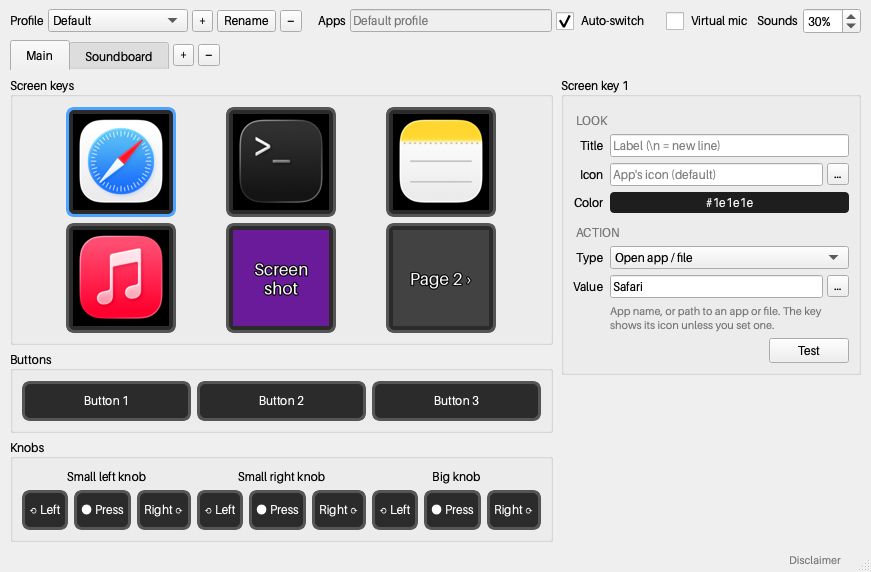
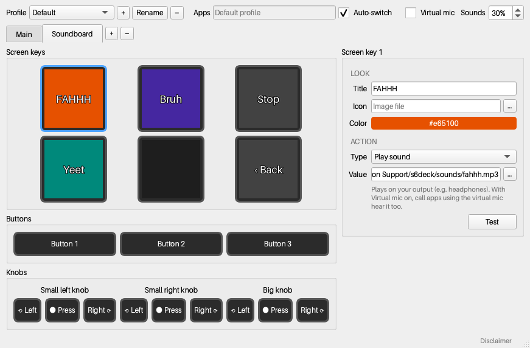
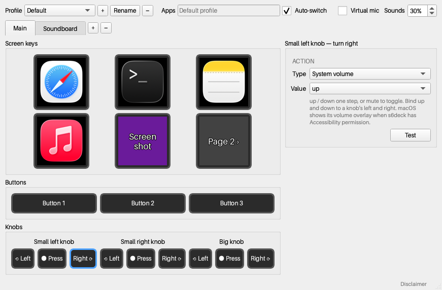
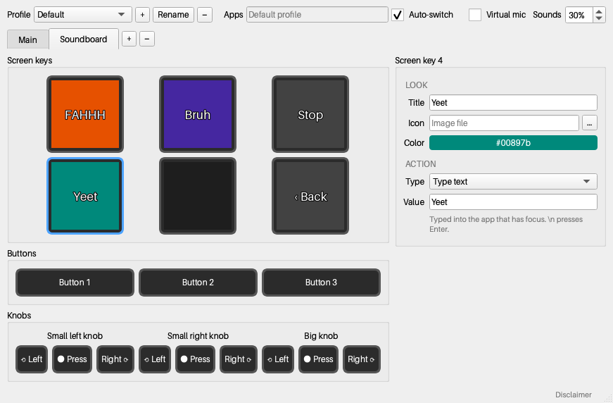

# s6deck

A local-only controller app for the **Streonor S6** stream deck (a MiraBox StreamDock-family device): six screen keys, three buttons and three knobs. It replaces the vendor software with a small Python/Qt app that talks to the device directly over USB. No Chromium, Node, cloud account, telemetry or network access.

Runs on macOS (tested). Windows and Linux code paths are written but not yet tested on hardware.



| Soundboard page | Knob bound to system volume | Type-text key |
|---|---|---|
|  |  |  |

## Features

- **Keys show images**: a title and background color, a custom icon, or (for "Open app" keys) the app's own icon.
- **Actions** for any key, button, or knob turn/press:
  - keyboard shortcut, type text, open app/file, open URL, run shell command
  - system volume (native macOS overlay), system brightness (laptop + external monitors)
  - play sound / stop sounds (soundboard), button brightness
  - switch page, switch profile
- **Pages and profiles**, with profiles switching automatically to match the frontmost app.
- **Soundboard into calls**: sounds play in your headphones and, through a virtual microphone, to people in Google Meet/Zoom together with your voice.
- **Tray app**: closing the window keeps the deck working.

## Supported devices

| Device | USB ID | Status |
|---|---|---|
| Streonor S6 (3×2 keys, 3 buttons, 3 knobs) | `1500:3006` | Verified |

Other MiraBox-family models use the same protocol with different key counts, image sizes and input codes; each is one `DeviceModel` entry in [`s6deck/models.py`](s6deck/models.py).

## No network traffic

s6deck has no networking code and makes no network connections. Verified three ways:

1. **Source**: no networking imports or calls (`socket`, `http`, `urllib`, `ssl`, `asyncio`, `QtNetwork`, …) in `s6deck/`.
2. **Runtime**: after full startup (GUI, device engine, soundboard), the only networking modules loaded are `socket`, imported by pyobjc to reuse two exception classes, and `_socket`, imported by `typing_extensions` to read one type object. Neither opens a socket. `webbrowser` is loaded for the Open URL action.
3. **Live**: across 20 one-second samples of the running app, `lsof -i` showed zero internet sockets and `nettop` showed no traffic. The only socket was one local Unix-domain socket (macOS logging/IPC). `QtNetwork` is excluded from the app bundle entirely.

Reproduce the live check while the app runs:

```sh
PID=$(pgrep -f 's6deck.app/Contents/MacOS/s6deck')
lsof -nP -a -i -p "$PID"          # prints nothing: no internet sockets
nettop -P -L 1 -p "$PID"          # no traffic rows
```

**What can reach the network**, only when you configure it:
- **Open URL** hands the URL to your default browser.
- **Run shell command** runs whatever command you set.

**Building** downloads dependencies from PyPI (and BlackHole via Homebrew for the soundboard). Using the app does not.

## Run from source

Requires Python 3.10+ (3.12 used) and [uv](https://github.com/astral-sh/uv) (or pip).

```sh
uv venv --python 3.12 .venv
uv pip install --python .venv/bin/python -e '.[dev]'
.venv/bin/python -m s6deck            # --hidden starts in the tray, --verbose logs debug output
.venv/bin/python -m pytest            # unit tests
```

Quit the vendor Streonor app first; only one program can drive the device at a time.

**Linux** needs permission to open the device without root:

```sh
echo 'SUBSYSTEM=="hidraw", ATTRS{idVendor}=="1500", ATTRS{idProduct}=="3006", TAG+="uaccess"' \
  | sudo tee /etc/udev/rules.d/70-s6deck.rules && sudo udevadm control --reload && sudo udevadm trigger
```

## Build the standalone app

```sh
uv pip install --python .venv/bin/python -e '.[build]'
.venv/bin/pyinstaller --noconfirm packaging/s6deck.spec     # → dist/s6deck.app (macOS), dist/s6deck/ (Win/Linux)
dist/s6deck.app/Contents/MacOS/s6deck --self-test          # checks every bundled native library
```

Build on each target OS; PyInstaller doesn't cross-compile. The spec drops unused Qt plugins/translations, QtNetwork, and Pillow's AVIF/WebP/color-management codecs (macOS app ≈ 90 MB, mostly Qt and the Python runtime). The macOS build is ad-hoc signed: it runs on the machine that built it; elsewhere, open it with right-click → Open the first time.

App icons are generated from `s6deck/assets/mickey_source.png` with `tools/build_icons.py`.

## macOS permissions

| Permission | Needed for | Prompted |
|---|---|---|
| Accessibility | keyboard shortcuts, type text, volume and brightness keys | first use (System Settings → Privacy & Security → Accessibility) |
| Microphone | virtual mic (forwarding your voice to calls) | when Virtual mic turns on |

Rebuilding the app changes its ad-hoc signature, so macOS asks for Accessibility again.

## Soundboard in calls

Call apps read a single microphone, so s6deck forwards your real mic plus soundboard clips into a virtual audio device, which you select as the call's microphone.

1. Install a virtual audio device:
   - **macOS**: [BlackHole 2ch](https://existential.audio/blackhole/) (`brew install --cask blackhole-2ch`)
   - **Windows**: [VB-CABLE](https://vb-audio.com/Cable/)
   - **Linux**: a PulseAudio/PipeWire null sink named `s6deck_mic` (`pactl load-module module-null-sink sink_name=s6deck_mic`)
2. Check **Virtual mic** in s6deck. "Sounds" sets clip volume (default 30%); your voice is unaffected.
3. In the call app, choose **BlackHole 2ch** (or CABLE Output) as the microphone. If effects get muffled, turn off the call app's noise cancellation.

Clips also play on your current output device (e.g. headphones).

## Configuration

One JSON file, saved automatically shortly after each change (atomic write):

| OS | Path |
|---|---|
| macOS | `~/Library/Application Support/s6deck/config.json` |
| Windows | `%APPDATA%\s6deck\config.json` |
| Linux | `~/.config/s6deck/config.json` |

It holds profiles → pages → bindings keyed by control (`key:0`, `button:1`, `knob:2:left`), plus brightness, auto-switch and soundboard settings. Icons and sounds are referenced by path, not copied. [`docs/demo-config.json`](docs/demo-config.json) is the config shown in the screenshots. Start with another file using `--config PATH`.

Packaged builds log to `~/Library/Logs/s6deck.log` (macOS) or next to the config file.

## Packages

| Package | Version | License | Used for |
|---|---|---|---|
| [PySide6-Essentials](https://pypi.org/project/PySide6-Essentials/) (Qt 6) | 6.12 | LGPL-3.0 | window, tray, settings UI |
| [hidapi](https://pypi.org/project/hidapi/) | 0.15 | BSD / GPL-3.0 | USB HID communication with the deck |
| [Pillow](https://pypi.org/project/Pillow/) | 12.3 | MIT-CMU | composing key images, JPEG encoding |
| [pynput](https://pypi.org/project/pynput/) | 1.8 | LGPL-3.0 | keyboard shortcuts, typing text |
| [pyobjc](https://pypi.org/project/pyobjc/) (Cocoa, Quartz) | 12.2 | MIT | macOS: app icons, frontmost app, media keys |
| [sounddevice](https://pypi.org/project/sounddevice/) (PortAudio) | 0.5 | MIT | virtual-mic audio stream |
| [soundfile](https://pypi.org/project/soundfile/) (libsndfile) | 0.14 | BSD-3-Clause | decoding MP3/WAV/… clips |
| [numpy](https://pypi.org/project/numpy/) | 2.5 | BSD-3-Clause | mixing mic and clip audio in real time |
| Aileron Regular (bundled in Pillow) | — | CC0 | the app's single font (UI and key titles) |
| [PyInstaller](https://pypi.org/project/pyinstaller/) | 6.22 | GPL-2.0 + bootloader exception | building the standalone app (build only) |
| [pytest](https://pypi.org/project/pytest/) | 9.1 | MIT | tests (dev only) |
| [BlackHole](https://github.com/ExistentialAudio/BlackHole) | 0.7 | GPL-3.0 | virtual audio device, installed separately |

## Project layout

```
s6deck/
  protocol.py   USB packet format (commands, image upload)
  models.py     per-device specs: key grid, image size/rotation, input codes
  device.py     one connected device: writes, heartbeat, images, input
  controls.py   raw input codes → key/button/knob events
  engine.py     background loop: connect, render pages, dispatch actions, follow frontmost app
  actions.py    host actions (shortcuts, typing, launch, volume, brightness, …)
  audio.py      soundboard and virtual mic
  render.py     key image composition;  app_icons.py: per-OS app icon lookup
  config.py     JSON config model and storage;  fonts.py: the app font
  gui/          Qt window: deck view, binding inspector
packaging/      PyInstaller spec and launcher
tools/          probe/listen (protocol exploration), icon builder, screenshot renderer
```

## Device protocol

Reverse-engineered from the vendor app's device library and confirmed on hardware.

**Output to the device** (HID output reports): report ID `0x00` followed by a 1024-byte payload.
- Commands start with `CRT\0\0`:
  - `DIS` wake, `HAN` screen off
  - `LIG\0\0<0-100>` brightness
  - `CLE\0\0\0<key|0xFF>` clear a key or all keys
  - `STP` refresh
  - `CONNECT` heartbeat; without one every 10 s the firmware falls back to its logo
- Key images: `BAT\0\0<u16 size big-endian><key>`, followed by the JPEG in 1024-byte chunks. The S6 takes 64×64 JPEGs rotated 90° clockwise.

**Input from the device**: `ACK\0\0OK\0\0<code><state>`.
- S6 keys: codes `0x01`–`0x06`
- Buttons: `0x25`, `0x30`, `0x31`
- Knobs (left / right / press):
  - small left: `0x90` / `0x91` / `0x33`
  - small right: `0x60` / `0x61` / `0x34`
  - big: `0x50` / `0x51` / `0x35`

## License

s6deck is released under the [MIT License](LICENSE). Third-party components and their licenses are listed in [THIRD_PARTY_NOTICES.md](THIRD_PARTY_NOTICES.md), with full texts in [THIRD_PARTY_LICENSES.txt](THIRD_PARTY_LICENSES.txt); built apps include all three files. Regenerate the notices with `.venv/bin/python tools/collect_licenses.py` after changing dependencies. The MIT license covers s6deck's code, not the app icon (see below).

## Disclaimer

s6deck is an independent project, not affiliated with, endorsed by, or sponsored by Streonor, MiraBox, or The Walt Disney Company. The app icon depicts Mickey Mouse as he appeared in Steamboat Willie (1928), which is in the public domain in the United States; Mickey Mouse is a trademark of Disney Enterprises, Inc.
